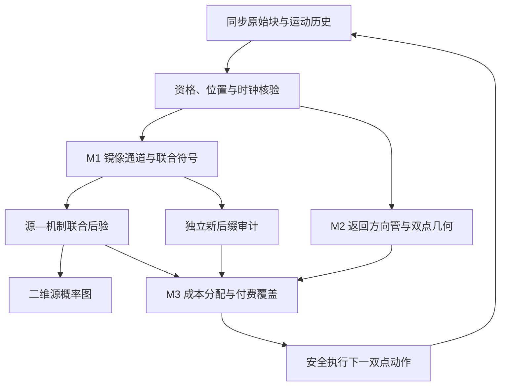

# V7 方法架构与实际在线闭环

## 1. 一条主旨与三项候选

统一主旨：**取得能够区分竞争源的合法观测，并让新观测持续检查当前源判断。**输出仍是二维气源位置概率质量图，允许使用两台同步传感器或双无人机。两机提供的额外资源不是算法创新；全部主比较使用相同两机、实际时钟、合法动作和总资源。

M1 是主候选：源对覆盖的镜像嗅觉联合通道。M2 是观测几何辅助：相对边界返回方向管及响应差编队。M3 是恢复辅助：全候选付费反证与独立新后缀审计。原论文算子、我们新增运算及失败条件详见 `THREE_INNOVATIONS_AND_THEORY.md`；这里给工程信息流。

## 2. 原生 PMFS 从哪里改到哪里

| 官方链条（固定源版本见 SOURCE_AUDIT.json） | V7 对应环节 | 保留/改变 |
|---|---|---|
| StopAndMeasure 有限窗浓度均值阈值 → 空间命中图及置信度 | 记录原始同步双侧窗口、传感器位置、真实时钟；M1 一次联合编码 | 替换中间观测表示；正确 readout 只是必要 A′ 适配 |
| 每个候选源的二维粒子前向响应 → 命中概率图 | 独立 TRAIN 标定的 `P(z|s,r,a)`；共享机制及合法未来联合符号采样 | 替换前向比较对象；有限表还不能泛化到未标定源 |
| 地图逐格相容因子乘积、归一化覆写 | 同一原始块进入 `(source,nuisance)` 后验一次，再对机制边缘化 | 标准归一化不计创新；不得误写原 PMFS 为每轮乘旧后验 |
| 当前分数加权的模拟响应方差 × 未观测置信度 | M2 形成动作几何，M3 成本约束源对分配、覆盖和反证挑战 | 保留主动选点目标，替换实际动作价值 |
| 方差低判定 success | 输出完整概率图、审计列表和资格；默认预算运行，不用低方差自动宣告真源 | 原 success 不作为真实定位成功标签 |

## 3. 数据流

图中的审计和后验使用同一原始事件各自完成不同决策计算；**审计值不回乘后验。**M2 读取实际 motion history 和 TRAIN 预测的均值、梯度、协方差；它不读取真源、未来风或测试世界的完整响应库。

## 4. 接口、张量和所有权

| 接口 | 形状/字段 | 所有权与资格 |
|---|---|---|
| `SynchronousBlock` | `values[T,P]`, `times_s[T]`, `positions_m[P,3]` 或 `[T,P,3]`，可选 `wind[T,P,3]` | 环境实际输出；通用接口支持 1/P 个传感器，V7 M1 使用 P=2 |
| 标定集合 | `[action,source,mechanism,block,time,2]` | 真源标签只在 TRAIN 标定或评价侧使用；完整 realization 不跨 split |
| M1 算子状态 | 每动作通道索引、阈值、固定合法核库 | 核参数当前预设，训练选通道与标定分布；不是训练自由核的精确母方法复现 |
| 联合通道 | `[A,S,R,O]` | 所有统计来自 TRAIN；未来联合采样一次 rollout 只抽一个共享 R |
| 后验 | `[S,R]`，源边缘 `[S]` | 初始先验全正；不以 Top-K 砍合法源；真实零支持触发模型问题 |
| M2 几何预测 | `centers[N,2]`, `means[N,S]`, `gradients[N,S,2]`, `cov[N,S,2,2]` | 由训练响应拟合或经过资格审查的前向预测提供，不把几何分数当 likelihood |
| M2 动作输出 | 中心、双机间距/方位、端点、全源对 contrast | 安全端点、轨迹、线性近似、计费范围仍须检查 |
| M3 输出 | 合法动作分布、成本、challenger、compatible/current 和 anytime 列表 | 覆盖分布不受源后验压低；预算末端明确限制到可支付动作 |

## 5. 每个在线步骤真正做什么

1. 从历史原始账本与当前传感器状态开始；加载冻结的概率模型，不访问评价真值。
2. 用已经发生的稳定进入/退出事件更新返回方向。将过期方向、无风条件下不合法的风门控、静止扫掠等记忆拒绝并记录。
3. 根据训练均值/梯度差和联合协方差，给全部合法双点动作生成对比矩阵。M2 提供 exploitation 子集；付费 global coverage 仍保留所有可支付合法动作。
4. M3 在当前联合预测中计算完整源对 KL，正确优化期望信息/期望成本。若 max-min 因不可分对为零，显式安排成对挑战或覆盖，不暗中退回 EIG。
5. 若独立 audit 已与当前高后验候选冲突，从仍相容列表选择挑战对象。这只改变下一动作，不抹去、重权或重复加入旧数据。
6. 在新结果到来前 `AuditLedger.prepare(action)` 冻结替代预测；执行动作并计入真实飞行、停留与两机资源。
7. 返回真实块后核查动作几何、时钟、cost、realization；写入不可重复原始账本。M1 得到一个符号；源后验与 audit 各接收同一事件一次。
8. 输出二维源概率、审计列表、下一步诊断。到预算结束停止；当前没有未经资格的“风险保证式原生停止”。

## 6. 三模块如何独立消融

M1 可以接固定回放、标准 EIG 或同一个 M3，不依赖 M2 memory。M2 的记忆可以关闭，保留无记忆的响应差几何；也可以只保留母方向管、不使用源 contrast。M3 可替换成标准联合 EIG、直接成本 Chernoff、无覆盖、无 audit-feedback；全部共享相同 M1 与原始观测权限。

完整 `configs/control_matrix.yaml` 已实现 13 变体，但其中 `A_adapted_variance` 仅为适配有限通道中的方差基线，不等于完整 ROS PMFS。原生 1U/2U 基线需按实验合同在本地 executor 上完成。

## 7. 已运行与尚未接通

当前 `engine.py` 提供真正运行的可控在线循环。`navigation/bridge.py` 提供 JSONL 进程桥，已与独立解析服务器跑通；它不是已经完成的 ROS/GADEN executor。`block_pipeline.py` 提供资格化训练、固定回放，严格先选 split 再开字节。`m2_boundary/calibration.py` 是普通 TRAIN-only RBF 结构适配；没有合格连续物理输入时不会凭空产生有效梯度。

固定表对机制的条件独立假设、有限采样估计误差、未见源泛化、真实传感器/旋翼扰动与行动空间的资格，是后续科学验证项。现有代码会保存这些边界，不用布尔 PASS 替代真实标定。
