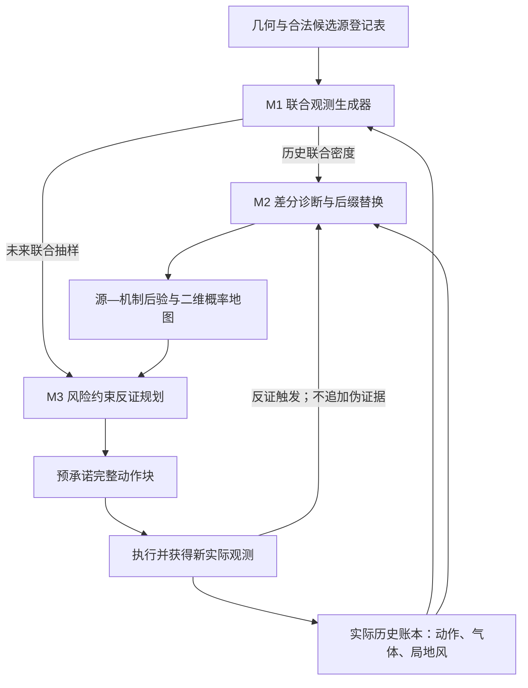

# SOURCE EVIDENCE RECOVERY V1：统一方法与条件性理论

**冻结版本：V1；性质：可实施科研候选及受控参考实现。** 本文件解释实际代码中的 M1、M2、M3，给出可以严格推出的性质及其条件。不把受控后端运行成功写成 House、原生 PMFS 或湖岸实飞性能已经验证。工程状态、测试次数和实验结果以 `IMPLEMENTATION_AUDIT.md` 的最终收据为准。

## 1. 统一目标、接口与在线信息流

### 1.1 唯一主旨

在间歇性气体传播环境中，提高竞争源的可辨识性，并利用可靠观测证据主动纠正错误源位置判断。最终输出仍是二维源位置概率地图；原生 PMFS 的主动定位任务与行动闭环得到保留。被替换的是前向响应与观测统计之间的联系、错误机制下的证据处理以及主动下一观测块的价值函数。

令合法源登记表为 $\mathcal S=\{s_1,\ldots,s_N\}\subset\mathbb R^2$，且先验 $\pi_0(s)>0$。二维源坐标不意味着内部传播只能二维；当前受控参考模型采用二维局地风，原生三维传播后端需要另行资格检查。动作

$$a_t=(x_t,y_t,z_t,\tau_t,d_t)$$

包含位置、高度、时间及驻留。一次实际观测为 $O_t=(U_t,Y_t)$：$U_t\in\mathbb R^2$ 是实际可获取的局地风，$Y_t\in\{0,1\}$ 是预先冻结读出规则产生的检出位。原始浓度不能在加载时被静默改阈值。历史

$$H_t=\{(\mathrm{id}_j,a_j,U_j,Y_j)\}_{j=1}^t$$

由不可重复编号的账本保存。机制目录 $\mathcal E$ 在测试前声明，每个 $e=(m,u,d,\eta)$ 包含类型、起点、持续时间与幅度；当前受控实现支持 nominal、sensor offset、wind bias、detection loss。

### 1.2 三模块接口

| 模块 | 输入 | 核心运算 | 输出及接收者 |
|---|---|---|---|
| M1 主创新：源证据微分监督联合生成器 | 候选源、实际历史、动作、固定机制；训练期合格物理教师 | 因果联合密度；源 score 弱监督；风保持 lift 与分支补偿 | 历史 `log_prob` 给 M2；合法未来 `sample_future` 给 M3；源 score 供训练/审计 |
| M2 辅助创新：机制差分诊断与可撤销回放 | 账本、源登记表、机制目录、M1 | 观测/参考的共享编码差分；有限预算 proposal；旧后缀减去并替换 | 源—机制联合后验、二维源边缘概率、证据替换收据 |
| M3 辅助创新：容错反证与可恢复列表 | M1 未来联合分布、M2 后验、合法动作块、额外污染预算 | 联合软码本；风险约束功效 LP；全局挑战轮转与恢复列表调度 | 完整预承诺动作块、检验、调度列表；新实际观测回到账本 |

公共调用形式为 `log_prob(history, source, mechanism)` 与 `sample_future(history, actions, source, mechanism, rng)`。后者只返回新增观测，不修改原历史。环境真源仅存在于环境/评测对象；规划器得到的是候选源登记表，不能调用真实源、未来真风或真实响应库选点。

### 1.3 一轮在线步骤

1. 校验账本 ID、时间顺序、读出和坐标单位；保留全部合法源登记项。
2. M1 对每个源和固定机制计算规范化历史联合密度。M2 可以完全枚举机制，也可用差分诊断分配有限回放预算。
3. 对机制起点以前保留原解释，对从起点到当前的整个受影响后缀撤销旧因子、以新机制重算并替换。形成 $P_t(s,e)$ 与 $P_t(s)=\sum_eP_t(s,e)$。
4. 导航层产生满足空间/动作约束的有限短动作块。M1 在当前实际历史条件下，逐步抽未来风和气体，形成每个源—机制的整块软码分布。
5. M3 选当前高后验源为待反证 null，同时安排低后验合法源进入挑战集合。全局轮转保留至少一个槽；其他槽优先近期恢复/兼容候选。
6. 对各动作块求最坏机制及额外污染下的反证功效，满足风险预算后选择单位成本价值最大的块。没有正的认证增益则明确回退 joint EIG，不伪造反证有效。
7. 冻结动作、模型/机制/读出/污染语义版本及检验；执行整个块。途中更改动作必须废弃旧检验，不能用已偏离计划的观测继承原证书。
8. 原始新观测只入账一次。反证结果可触发 M2 回放及恢复调度，但不再作为第二个 likelihood 因子。旧版本列表失效并恢复候选资格；继续下一轮。

## 2. 从 PMFS 原生环节到三项二次创新

PMFS 使用概率测量地图、候选源前向模拟及源概率地图支持主动搜索。原文及官方实现是经典基线，不是固定路线估计器。项目 B4 等历史审计提供“错误高置信”“预测改善但源排序不稳定”的动机；这些工程评分比不是已校准物理似然比。本文件不把所有失败统一归因于三维效应、湖陆风或时间相关性。

| 模块 | A：原生不足 | A′：结构适配 | B：母算子迁移 | B′：气源二次创新 |
|---|---|---|---|---|
| M1 | 响应场拟合不直接约束竞争源证据；主动规划需要合法未来联合分布 | 同一规范化 AR 联合生成器，仅 NLL | 自然高斯噪声上的无风约束响应 lift/积分分部权重 | 固定实际风条件的源切向 lift、含散度权重、硬路由分支两侧补偿，监督源证据导数 |
| M2 | 没有显式针对机制变更的历史解释撤销/回放接口 | 原始账本与 nominal 规范化密度 | 共享编码器的观测/参考差分；机制切换仅作用最新因子作为直接迁移对照 | 每个竞争源各自的机制参考；防御性 proposal 与正确权重；整个受影响后缀替换 |
| M3 | 错误高置信时方差式信息价值会压低其他源；简单码距不能处理真实联合分布 | M1 支持的 joint EIG | 按动作的响应聚类及跨簇分离规划 | 复合 null 风险约束、额外污染集合、软反证功效、低概率源恢复调度及版本失效规则 |

这里的 A 必须来自冻结官方运行或其原始结果适配器。受控源码中 A 的方差价值代理只复现相应公式部分，不能冒称完整官方 PMFS。M2 的 B 是跨领域差分诊断在本任务中的直接迁移对照，不是原作者气源算法。各模块的规范化、积分和 Bayes 规则属于必要结构，不单独列为创新。

### 2.1 跨领域来源与借用边界

- **随机分析/条件生成**：ICML 2025，*Conditioning Diffusions Using Malliavin Calculus*。借用的是把条件响应分布导数转换为自然随机噪声上的积分分部权重这一计算机制；本工程没有声称复现完整条件扩散采样器。正式题录：[PMLR 267](https://proceedings.mlr.press/v267/pidstrigach25a.html)，[全文](https://arxiv.org/html/2504.03461v2)。
- **计算机图形学/可微渲染**：ACM TOG、SIGGRAPH Asia 2025，*Automatic Sampling for Discontinuities in Differentiable Shaders*，DOI `10.1145/3763291`。借用硬分支边界定位及两侧执行轨迹的测度贡献。本工程实际实现一维自然噪声门的 coarea 特例，未实现通用 shader 自动编译器、多维分支发现和全部 proposal 校正。[作者项目](https://yashbelhe.github.io/asd/index.html)，[作者代码](https://github.com/yashbelhe/ASD)。
- **计算生物学/扰动靶点识别**：ICML 2025，*Identifying Biological Perturbation Targets through Causal Differential Networks*。迁移共享数据集编码器与两条件差分表示，输出扰动机制 proposal；本工程用小型共享 tanh 编码器实现该具体运算，没有把完整原网络架构写成已复现。[PMLR 正式题录](https://proceedings.mlr.press/v267/wu25v.html)，[全文](https://arxiv.org/html/2410.03380v4)，[作者代码](https://github.com/rmwu/cdn)。
- **信息论/主动序贯识别**：IEEE ISIT 2025，*Multi-Stage Active Sequential Hypothesis Testing with Clustered Hypotheses*，DOI `10.1109/ISIT63088.2025.11195532`。借用动作相关响应聚类、代表假设比较与分阶段识别；气体软码规划不直接继承其独立同分布序贯定理。[正式机构题录](https://cris.technion.ac.il/en/publications/multi-stage-active-sequential-hypothesis-testing-with-clustered-h/)，[全文](https://arxiv.org/html/2501.11459v2)。
- **PMFS 基线**：[Ojeda 等原文](https://arxiv.org/html/2304.08879v3)，[MAPIR 官方 gas_source_localization](https://github.com/MAPIRlab/gas_source_localization)。源码冻结与 B4 原始证据身份以项目审计文件为准。

## 3. M1：联合分布与源证据监督

### 3.1 实际生成器

对适应性动作策略，使用因果密度而不是把整个未来真实风当条件输入：

$$q_\theta(O_{1:T}\Vert A_{1:T},s,e)=\prod_{t=1}^{T}q^U(U_t\mid H_{t-1},a_t,e)\,q^Y_\theta(Y_t\mid U_t,H_{t-1},a_t,s,e).\tag{1}$$

当前 CPU 参考实现以 34 维非线性特征 $\phi_t$ 编码源—测点位移、实测风、二次交互、tanh/径向基、前一检出及动作/机制。设

$$f_t=\sigma(w^T\phi_t),\quad p_t=r_e(t)f_t,\quad q^Y(Y_t)=p_t^{Y_t}(1-p_t)^{1-Y_t}.\tag{2}$$

$r_e(t)$ 是固定 detection-loss 机制的生存概率。风因子为二维 Gaussian AR，其均值、共享 AR 系数和残差方差默认只从合格训练集估计，并扣除预声明风偏差。输入不足或零残差会阻止拟合；不暗用受控默认风场处理 House。

**归一化性质。** 每一步风密度积分为 1，Bernoulli 两取值求和为 1；按时间反向逐步积分，式 (1) 的整块密度归一化。AR 使未来气体位相关，不能以边际检出率乘积替代联合码分布。当前有限记忆容量也不等于任意长程传播模型；这是可替换、可验证的接口边界。

**动作策略抵消。** 若策略只依赖已观测历史和允许随机数，联合数据似然另含 $\prod_t\pi(a_t\mid H_{t-1})$。比较相同实际历史下的候选源时，该因子对源相同而抵消。故在线主动路线与合法概率推断兼容；策略若偷看真源/未来真实响应，该论证失效。

### 3.2 风保持源切向 lift

固定一个合法历史前缀及当前动作。物理教师以自然随机变量 $\xi\sim\mathcal N(0,I_D)$ 产生连续读出前响应 $X_s(\xi)$、局地风 $U(\xi)$，实际位为 $Y=R(X)$。被动气体假设是源位置改变不改变气象风，即 $\partial_sU=0$；这不是说已有气体历史与未知风在统计上永远独立。

**额外条件 C_cond：**固定历史后的条件教师仍须具有源无关的自然噪声基准与源不变的风映射。被动气体只保证干预层面的风场不被气源改变，**不单独保证**在含气体观测的历史条件下 $p(U_t\mid H_{t-1},s)$ 与源无关。当前受控后端的风是完整观测的一阶 Markov 状态，满足这一条件；真实隐藏风/传播状态通常需要重新验证。若条件潜状态分布随源改变，应计入其 score，或在联合 lift 中使用 $J_Uv_i=\partial_{s_i}U$ 的实际条件切向量；不得强迫零切向量后仍宣称是真实联合分布的导数。这属于原生教师阻碍，V1 没有伪装为已解决。

记 $J_X=\partial_\xi X$、$J_U=\partial_\xi U$、$d_i=\partial_{s_i}X$。在 C_cond 成立时，为移动源响应而不改变同一次局地风读出，求

$$J_Xv_i=d_i,\qquad J_Uv_i=0.\tag{3}$$

令 $P_U=I-J_U^+J_U$。一个最小范数解是

$$v_i=P_UJ_X^T(J_XP_UJ_X^T)^+d_i.\tag{4}$$

**命题 1（可行性）。** 式 (3) 有解，当且仅当 $d_i\in\operatorname{range}(J_XP_U)$。满足此条件时，式 (4) 是位于风零空间中的最小欧氏范数解。

**证明。** $J_Uv=0$ 等价于 $v=P_Uv$，故任何可达响应切向都在 $J_XP_U$ 的像空间中。反之若 $d$ 在该像空间，$J_XP_U(J_XP_U)^+d=d$。正交投影与 Moore–Penrose 逆的最小范数性质给出式 (4)。□

源坐标二维本身不保证可行。如果所有自然噪声都是风噪声且 $J_U$ 满列秩，则 $P_U=0$，任何非零源切向均不可达。独立粒子扩散噪声可能提供可行方向，但必须检查残差。禁止添加人工噪声来假装教师满足原物理模型的可行性。

### 3.3 积分分部与分支边界

定义 Gaussian 散度权重

$$W_i(\xi)=\xi^Tv_i(\xi)-\operatorname{div}_\xi v_i(\xi).\tag{5}$$

散度必须包含 lift 对噪声的依赖，包括切向量及伪逆的变化，不能把它们提前 detach。当前一般算子使用中心有限差分；受控风保持 lift 仅有气体噪声分量且与该分量无关，其散度恰为零。

**命题 2（平滑区弱导数）。** 在分段光滑区，若式 (3) 成立、积分/微分可交换且边界尾项消失，则对固定测试函数 $h$，源扰动的分布导数可用 $\mathbb E[W_i h(O)]$ 表示，另加有限内部跳跃边界贡献。

**证明要点。** 链式法则将 $\partial_{s_i}h(X,U)$ 写成 $\nabla_\xi h\cdot v_i$；$J_Uv_i=0$ 消除风读出沿 lift 的变化。对 Gaussian 密度 $\varphi$ 积分分部，$-\operatorname{div}(\varphi v_i)=\varphi(\xi^Tv_i-\operatorname{div}v_i)$。内部边界不能丢弃。□

设硬门 $g(s,\xi)=0$ 两侧输出为 $O^+,O^-$，对应 lift 为 $v_i^+,v_i^-$。完整边界项为

$$\mathcal B_i[h]=\int\delta(g)\varphi(\xi)\left[(g_{s_i}-\nabla_\xi g\cdot v_i^+)h(O^+)-(g_{s_i}-\nabla_\xi g\cdot v_i^-)h(O^-)\right]d\xi.\tag{6}$$

式 (6) 来自移动积分域的边界项与每个区域积分分部的法向通量；符号分别由正区外法向与负区外法向决定。它不是对浓度损失加一个经验权重。

受控实现采用 $g=\xi_g-b(s)$、$v_g=0$，因此

$$\mathcal B_i[h]=-\partial_i b(s)\varphi(b(s))\,\mathbb E[h(O^+)-h(O^-)].\tag{7}$$

源码真正求门根、运行两侧读出并计算 coarea 系数。根非简单或括区无效时失败，不静默忽略。它是 ASD 思想的低维可审计实例，而非自动处理任意 GADEN 障碍碰撞的编译工具。

### 3.4 弱 source-score 目标及严格监督范围

对固定前缀定义

$$g_\theta(O;s,H,a,e)=\partial_s\log q_\theta(O\mid H,a,s,e).$$

采用

$$\mathcal L=\mathcal L_{NLL}+\lambda\left\{\mathbb E\|g_\theta\|^2-2\mathbb E[W^Tg_\theta]-2\sum_i\mathcal B_i[g_{\theta,i}]\right\}+\tfrac{\rho}{2}\|w\|^2.\tag{8}$$

在分布弱导数恒等式中，测试函数取当前 $g_\theta$，但源分布导数作用时把该测试函数视为固定；这不意味着训练参数梯度被停止。代码对 $g_\theta$ 和两侧 score 正常求参数导数，只有生成后的物理标签固定。

**命题 3（弱目标的含义）。** 若教师给出真实条件分布 $p_F(O\mid H,a,s,e)$ 的完整弱导数，并且 score 平方可积，则式 (8) 括号内等于

$$\mathbb E\|g_\theta-g_F\|^2-\mathbb E\|g_F\|^2,\quad g_F=\partial_s\log p_F.\tag{9}$$

**证明。** 弱导数给出 $\mathbb E[W^Tg_\theta]+\sum_i\mathcal B_i[g_{\theta,i}]=\mathbb E[g_F^Tg_\theta]$；展开平方即可。□

实际优化的是**固定前缀的一步条件源 score**，不是整块 joint Fisher 风险的直接最小化。固定实际观测序列下，

$$\partial_s\log q_\theta(O_{1:T}\Vert A,s,e)=\sum_{t=1}^{T}\partial_s\log q_\theta(O_t\mid H_{t-1},a_t,s,e).\tag{10}$$

各步误差可能同向累积；一步平均风险下降不自动保证整块误差、未见源排名或 MAP 改善。NLL 保留了密度拟合与不同连通分区的概率质量约束，不能被局部导数监督完全替代。

### 3.5 与竞争源 margin 的可检验联系

**命题 4（条件性源对误差界）。** 假设源 $s_a,s_b$ 在合法源空间中可由长度 $L_\gamma$ 的路径连接，沿路径真实/模型联合密度正且可微。若每步条件 score 误差满足 $\|g_{q,t}-g_{p,t}\|\le\epsilon_t$，则

$$\left|\log\frac{q(O_{1:T}|s_a)}{q(O_{1:T}|s_b)}-\log\frac{p(O_{1:T}|s_a)}{p(O_{1:T}|s_b)}\right|\le L_\gamma\sum_t\epsilon_t.\tag{11}$$

**证明。** 两个 log-density 差沿路径由梯度线积分表示；使用式 (10)、Cauchy–Schwarz 和三角不等式。□

若真实源对带先验 margin 为 $M_p>0$，且右侧严格小于 $M_p$，模型保持这一对源的正确排序。这是充分条件，不是训练保证。需要以独立前缀、未见源及竞争源对验证。浓度 MSE 没有自动控制式 (11) 的性质，因而本模块有直接针对源间判别的理论接口。

### 3.6 数值与原生边界

概率使用 $10^{-12}$ 数值下限；饱和区导数与实际截断 likelihood 一致地归零，拐点不宣称经典导数存在。严格教师推导与数值证明限定在未触发截断的资格范围，并应报告触发率。

原生 GADEN 教师目前缺自然噪声资格、条件潜状态处理、读出前响应 JVP/VJP、硬分支 trace 与覆盖概率。历史固定并不允许简单忽略真实物理潜状态的后验；当前受控 AR 恰有显式一步转移，原生后端必须提供相应条件模拟器。这些是 `BLOCKED_NATIVE_TEACHER` 的具体位置，不是代码已经解决。无气体质量守恒、Navier–Stokes 一致性或 CFD 收敛定理在本工程被证明。

## 4. M2：机制差分诊断与可撤销回放

### 4.1 诊断 proposal 的实际计算

对实际历史描述 $D_{obs}$ 与候选源 $s$ 下 nominal 合法生成参考 $D_{ref,s}$，共享编码器得到

$$d_s=E_\phi(D_{obs})-E_\phi(D_{ref,s}),\qquad r_\phi(e|H,s)=\operatorname{softmax}(Vd_s+c).\tag{12}$$

实际实现以风 x/y 与气体的均值、标准差、相关、滞后及增量组成 21 维统计，经共享 tanh 编码器训练。它是可运行的 CDN 差分算子迁移，并非原论文完整架构复现。源条件参考避免把“假设源错了”都解释为“传感器/传播机制坏了”；训练必须含错源但 nominal 的负例。

网络输出仅用于选择回放机制，不是新观测。机制目录及顺序被绑定并保存在检查点；相同类别数但不同机制语义不得混用。

### 4.2 旧后缀替换

设 nominal 联合似然为 $L_s^0=q_0(O_{1:t}\Vert A,s)$，机制 $e$ 从 $u$ 开始，且起点前密度相同。定义

$$\log L_{s,e}=\log L_s^0-\log q_0(O_{u:t}|H_{<u},s)+\log q_e(O_{u:t}|H_{<u},s).\tag{13}$$

当前代码通过完整前缀/完整历史密度之差获得后缀，并保存删除与替换数值。持续时间结束不等于历史影响结束；完整后缀条件因子继续使用已经发生的实际观测。

**命题 5（不重复计数与等价重算）。** 若机制起点前密度一致，式 (13) 等于 $\log q_e(O_{1:t}\Vert A,s)$。

**证明。** nominal 由前缀乘旧后缀组成；相减消去且只消去旧后缀，再乘新后缀。前缀相同，得到完整新机制密度。□

故

$$P_t(s,e)=\frac{\pi_0(s)\pi(e)L_{s,e}}{\sum_{b,f}\pi_0(b)\pi(f)L_{b,f}},\quad P_t(s)=\sum_eP_t(s,e).\tag{14}$$

这是标准概率规则而非新发明。M2 的可研究增量是源条件机制提案、预算分配、历史替换及可审计恢复流程。完全枚举时，它必须与相同模型的标准机制 Bayes 给出同一个答案；不能把这当作需要“击败”的不同 posterior。

### 4.3 防御性重要性回放

预算有限时取

$$q_\phi(e|H,s)=(1-\varepsilon)r_\phi(e|H,s)+\varepsilon\pi(e),\quad 0<\varepsilon\le1,$$

并抽 $e_r\sim q_\phi$：

$$\widehat Z_s=\frac1R\sum_{r=1}^{R}\frac{\pi(e_r)}{q_\phi(e_r|H,s)}L_{s,e_r}.\tag{15}$$

**命题 6（无偏目标与支持）。** 对固定实际历史，$\mathbb E[\widehat Z_s|H]=\sum_e\pi(e)L_{s,e}$，且 $\pi(e)/q_\phi(e|H,s)\le1/\varepsilon$。

**证明。** 对抽样分布求和，$q_\phi$ 与分母抵消。防御性混合给出 $q_\phi\ge\varepsilon\pi$。□

诊断即使依赖同一历史也不破坏此条件恒等式；但 $\log\widehat Z_s$ 及 $\pi_0(s)\widehat Z_s/\sum_b\pi_0(b)\widehat Z_b$ 在有限样本下一般有偏。诊断的价值在于同预算的误差/方差，而非增加虚构证据。成本比较必须计入生成参考历史的费用。

### 4.4 何时能纠正错误 margin

令 $K_s=\sum_e\pi(e)L_{s,e}/L_s^0$。任意源对有精确关系

$$M_{new}(a,b)=M_0(a,b)+\log K_a-\log K_b.\tag{16}$$

因此当原先真源 $a$ 相对错源 $b$ 的 $M_0<0$，若 $\log K_a-\log K_b>-M_0$，回放翻转这一错误排序。式 (16) 说明修复需要**对真源更有区分性的机制解释**。若错源也能同样解释异常，或目录缺真实机制、机制自由度足以拟合任意源，则没有纠正保证。

## 5. M3：联合软码、风险约束反证与恢复调度

### 5.1 软码本与额外错误

对动作块 $Q=(a_{t+1},\ldots,a_{t+L})$，令 $C=(Y_{t+1},\ldots,Y_{t+L})\in\{0,1\}^L$。M1 生成

$$p_{s,e}^Q(c)=\Pr_q(C=c|H_t,Q,s,e).\tag{17}$$

风被合法抽样并积分，不能用未来真实风。普通 plume 间歇、源条件不确定性和时间相关已属于 $p$。额外传输/传感故障用集合 $\mathcal N(c)$ 描述：最多指定个数翻位、显式擦除符号 $-1$，或一段有界连续 burst，可保守组合。码长 V1 限于 $1\le L\le8$，避免把指数枚举伪装成大规模实时能力。

### 5.2 容错复合 Neyman–Pearson LP

当前 incumbent 为 $h$，挑战集合为 $\mathcal C$。随机拒绝函数为 $\varphi(y)\in[0,1]$；对每个干净码字定义

$$u_c\ge\varphi(y),\quad v_c\le\varphi(y),\quad\forall y\in\mathcal N(c).$$

求

$$\max\beta\quad\text{s.t.}\quad\sum_cp_{h,e}(c)u_c\le\alpha\;\forall e,\qquad\sum_cp_{s,e}(c)v_c\ge\beta\;\forall s\in\mathcal C,e,\qquad0\le\varphi,u,v,\beta\le1.\tag{18}$$

动作价值为 $(\beta-\alpha)_+/\mathrm{cost}(Q)$。它关注在保护 incumbent 风险的同时实际拒绝错误 incumbent 的能力，不等于最大硬码距。挑战机制使用最坏情况；机制不分离时，保守规划可能无增益。

**命题 7（零分布半径时的精确性）。** 对有限已知码分布及允许每个干净码字内选择污染结果的对手，式 (18) 等价于最优最坏情况随机反证检验。

**证明。** null 对手逐个 $c$ 选择最大的拒绝概率，故风险为 $\sum_cp_h(c)\max_{y\in\mathcal N(c)}\varphi(y)$；alternative 对手选择最小值，故功效为相应 min 的期望。引入 $u,v$ 是这两个运算的标准 epigraph/hypograph 表示，无放松误差。□

**不可分边界。** 若某个允许 null 与 alternative 经允许污染后能得到相同分布 $R$，任何满足 null 风险 $\alpha$ 的检验在该 alternative 上功效不超过 $\alpha$。因此求解出零增益是信息不足的有效结论，不能靠修改阈值、真源或轨迹把它变成正结果。

### 5.3 有限样本分布误差

每个软码分布以 $n$ 条完整模型轨迹估计，支持数 $K=2^L$。对事前有限行动池、全部源与机制共 $M$ 个分布，使用有限字母浓度界

$$r=\min\left(1,\sqrt{\frac{K\log2+\log(M/\delta)}{2n}}\right).\tag{19}$$

联合概率至少 $1-\delta$ 时，所有这些模型分布与经验分布的 TV 距离不超过 $r$。全行动池联合覆盖允许根据这些样本选动作，不能只为最终挑中的动作事后计算一个单分布置信界。

对任意 $f$，TV 球内有

$$|E_pf-E_{\hat p}f|\le r(\max f-\min f).\tag{20}$$

LP 对 null 加 $r(\max u-\min u)$，对 alternative 减 $r(\max v-\min v)$。范围变量使其仍为 LP。零半径为精确问题；非零半径一般保守，不宣称是精确 TV 鲁棒最优功效。代码另用概率质量搬运重算风险，核验解的证书。

式 (19) 只控制**生成器内部 MC 误差**，不控制物理模型失配。若真实清洁码分布与模型之间另有已验证 TV 上界 $\epsilon_{phys}$，单块真实风险才可再放宽为 $\alpha+\delta+\epsilon_{phys}$；没有该资格时，不得把模型证书说成湖岸物理风险证书。

### 5.4 序贯风险、预承诺及弃权

第 $k$ 个完整块使用 $\alpha_k=\alpha_{tot}/[k(k+1)]$，MC 预算同样可按可求和序列分配。只要每次检验条件于旧历史有效，且所有当前 null 的机制真值在目录内，则由条件期望与并集界，任意时刻误拒绝真实源的总风险至多

$$\sum_k(\alpha_k+\delta_k+\epsilon_{phys,k}),\tag{21}$$

额外污染超预算事件还应加其发生概率。若物理误差界未知，只报告模型条件性部分。检验必须使用未被用于旧检验的实际观测块，不能因模型更新把旧数据重新算成独立样本。中途路线变更、版本不匹配或重复消费计划使原证书失效。

当所有动作的认证功效增益非正，M3 回退 joint EIG 并记录理由。允许合法弃权是本方法的一部分；不能把 fallback 所得收益计成容错反证模块的独立贡献。

### 5.5 可恢复列表

为每个源—机制选集合 $A_{s,e}$，使经验质量至少 $1-\eta+r_{s,e}$；超过 1 时保留完整支持。收到 $y$ 后定义

$$\mathcal L(y)=\{s:\exists e,\exists c\in A_{s,e},\ y\in\mathcal N(c)\}.\tag{22}$$

在 TV 事件成立、真实机制在目录内且污染有界时，真源进入本块列表的概率至少 $1-\eta$。证明是 $p(A)\ge\hat p(A)-r\ge1-\eta$，而 $C\in A$ 且允许污染必使真源兼容。

当前列表是调度资格，不是永久置信集，不用于把后验置零。每个新块替换当前列表；额外挑战槽优先最近恢复及兼容源，同时全局轮转槽保证列表外合法源仍会被检查。模型、机制或读出/污染语义更新后旧列表恢复，旧检验不能沿用。跨块累积排除若要成为长期置信集合，需要另设覆盖风险支出，V1 未声称该保证。

## 6. 可独立消融、物理解释与研发判据

### 6.1 必须分别验证的作用

| 对照 | 冻结什么 | 预期识别的作用；不能预先宣称有收益 |
|---|---|---|
| M1 Aprime / B / Bprime | 同一特征、训练源、优化预算与风拟合 | 结构适配、直接权重迁移、风保持及边界二次创新 |
| M1 Bprime_no_boundary | 仅去掉两侧边界项 | 在存在源相关硬门时，检查 score/margin 偏差是否按推导出现 |
| M1 Bprime_no_wind_constraint | 保留边界，取消风约束 | 检查改动风读出是否损害联合源证据监督 |
| 同容量 NLL/更强标准生成器 | 相同数据和合法未来接口 | 避免只打败不满足条件的直接迁移 B |
| M2 nominal / 最新因子切换 / 整后缀替换 | 同一 M1 与机制目录 | 旧错误证据被系统撤销的增量 |
| M2 uniform、prior、source-blind、source-aware proposal | 同一预算且计入参考生成成本 | 诊断提案带来的计算效率与后验误差，exact 枚举是目标参照 |
| M3 joint EIG、污染鲁棒 EIG、硬最小码距、聚类 ASHT、Bprime | 同一动作池、航行成本、模型抽样预算 | 风险约束反证的独立行动收益 |
| M3 去掉恢复优先槽/全局轮转 | 同样允许合法源登记表 | 低后验真源获得复查机会的贡献 |

M1 的形式训练损失降低只是实现/优化证据。论文必须同时检查未见源 log-score margin、排名、MAP/Top-5%误差、错误高置信及原本正确案例退化。M2 的后验改动也不能单靠“方差下降”判成功。M3 必须报告风险预算、实际功效、fallback、恢复列表大小和总行动成本。

**强对照的数值资格。** `robust_eig` 在相同污染邻域允许的公共随机信道 $T(y|c)$ 上最小化联合互信息。固定源先验与清洁码分布时目标关于 $T$ 为凸函数。实现采用行单纯形上的 pairwise Frank–Wolfe，线性最小化 oracle 给出 $g=\langle\nabla f(T),T-V\rangle$，因此 $0\le f(T)-f^*\le g$；互信息非负另给 $f^*\ge0$。最终证书取 `min(f(T), g)`，要求不超过 $10^{-5}$ nats，同时核验行归一化与非负约束。未通过即失败，不以优化器 success 标志替代证书。该数值对照的正确性并非本论文新增创新点。

### 6.2 物理性质的准确范围

已编码的物理/因果约束是：被动气体不改变气象风；源与测点连续位置具有明确含义；仅使用已观测历史；机制起点前不生效；未来风由模型生成；额外污染与正常间歇分开；二维输出是源边缘概率。受控后端用随机阈值响应及路由门检验这些算子。

没有证明三维流体方程、质量守恒或湖陆风正确性。地图几何、实际传感器响应、传播收敛与候选支持资格是独立数据/后端条件。任何不合格场景不得靠上述抽象定理获得实验资格。

### 6.3 成本及停止边界

M1 特征维 $F=34$，历史密度约 $O(TF)$，一次参数目标约 $O(NF+N_w\cdot2F)$；一般有限差分散度需要 $O(D)$ 次 lift，原生高维需 JVP/VJP 等新实现。M2 当前精确参考约 $O(N|\mathcal E|T)$，不是已优化缓存系统。M3 字母数为 $2^L$，有擦除时观测字母数可达 $3^L$，因此明确限制小块和有限动作池。

若原生 teacher range 条件不满足、分支测度无法评估、未来联合分布资格失败、真源不在合法支持、所有候选物理不可辨识，相关科学主张必须停止。其余代码仍可用于诊断、结构适配和受控验证。真正的成效条件是：在冻结独立评测上，B′相对 A′与强标准对照带来稳定源定位增量，并且代价与退化可接受。

**最终理论裁决：**三个模块组成可运行的同一闭环；M1 直接约束竞争源证据变化，M2 正确重算机制错误下的旧证据，M3 用有风险约束的未来观测主动检查当前判断。上述证明给出算子正确性、必要条件和可检验的充分条件，尚未给出真实场景性能提升定理，也不替代冻结实验合同。
