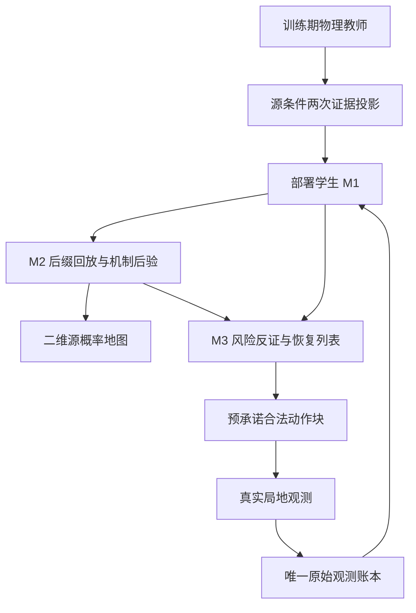

# V2 三模块方法：源证据投影蒸馏、机制回放与主动反证

日期：2026-10-23。这是可实施的科研候选及真实实现说明，不是已取得定位提升的论文结果。主选附件路线 B；原 V1 微分教师路线 A 保留，原生 GADEN 的 A+B 路线 C 仍须独立资格化。下文实验层级 A/A′/B/B′ 与附件路线字母不是同一含义。

## 1. 保持的任务与被改造的假设

唯一任务是：从合法气体与局地风观测生成二维源位置概率地图，主动选择下一观测块，并有能力重新检查错误高置信结论。输入为候选源坐标集合 S、静态几何 G、原始观测账本 H、可执行动作块集合 Q、固定机制目录 C。真实源只属于训练标签或独立评价器。

PMFS 原始流程包含测量地图、前向模拟、候选源地图兼容评分和主动选点。其地图兼容评分与逐个真实传感观测的规范化条件似然不是同一统计量。B4 错误尖峰和 M4/RK 的“预测改善但排序不稳”，支持重构证据表达与判别训练；它们没有证明所有失败都来自三维风场，也没有证明所有经典 Bayes 更新都会锁死。原生 PMFS 本来会重算地图评分，不能错误写成每轮反复乘旧后验。源码入口和原始证据复算见 V1 保留审计及 `examples/native_b4/`。

| 模块 | 原生能力缺口 | 跨领域母机制 | 本项目可执行的二次构造 |
|---|---|---|---|
| M1 主创新候选 | 平均响应拟合未控制源对证据误差；缺少同一模型的合法未来联合分布 | 特权 POMDP 的 history-belief 投影；组合 SBI 的条件/先验校正 score；V1 随机分析与不连续边界微分 | 每候选源重新过滤隐态；完整/过去两次边缘证据相减；端点＋中点方向监督同一规范化联合学生 |
| M2 辅助候选 | 错配解释改变后，没有显式机制目录下可审计的原始证据撤销/替换 | 计算生物学 CDN 的观测—参考共享表示差分 | 参考响应随源假设变化；诊断只提议机制；完整受影响后缀撤销并重放；保留全源支持 |
| M3 辅助候选 | 错误尖峰可能令低概率合法源失去观测机会；准确但不可分的码字不能纠错定位 | ISIT2025 动作相关聚类序贯假设检验；软译码与鲁棒检验 | 轨迹联合软码本、明确额外污染、风险—功效约束、低后验源轮转挑战和可恢复列表 |

母机制均不是新命名的通用网络。完整母论文题录、方法与未复现范围见 `literature/MOTHER_METHOD_AUDIT.md`。普通积分、Fisher 恒等式、GRU、LP、Bayes 归一化和重要性采样不独立算创新。

## 2. M1：教师先教合法源证据，再压缩给学生

### 2.1 输入、输出和权限

教师输入训练期外生物理 bank `[K,P,7]`（xyz、物理时间、三维风）、几何、候选源 s、历史 H、机制 c。一个 bank 原子不是一个真实源的气体快照；不同候选源必须都能在同一外生世界下被合法评估。原生气团或三维浓度可用于离线训练读出，不能把真源气团复制给错误源当外生变量。

学生输入只含 `[T,位置/时间/驻留/局地风/气体/mask]`、合法静态几何、连续候选坐标和预声明机制。它输出 `log_prob(H,s,c)` 和 `sample_future(H,Q,s,c)`；后者采样整段未来气体与局地风。连续候选坐标是正在检验的假设，不是真实源标签。教师 bank 和全场不进入部署 checkpoint。

### 2.2 两次边缘证据与源对监督

设每个外生原子有规范化、前缀一致的联合模型 p_j。定义

\[
L_s(H)=\log\sum_j\pi_j(s)p_j(H\mid s,c),\quad
w_{s,j}^{H}=\frac{\pi_j(s)p_j(H\mid s,c)}{\sum_k\pi_k(s)p_k(H\mid s,c)}.
\]

对事前动作块 Q 的未来观测 Y，教师只教

\[
\ell_s^T(Y\mid H,Q,c)=L_s(H,Y)-L_s(H).
\]

源导数必须同时包含两个过滤分布：

\[
g_s^T=\sum_j w_{s,j}^{HY}\nabla_s\log[\pi_j(s)p_j(H,Y\mid s,c)]
-\sum_j w_{s,j}^{H}\nabla_s\log[\pi_j(s)p_j(H\mid s,c)].
\]

这解释了为什么直接取某一个真风教师、冻结历史 belief、或先平均 log-likelihood 都不是相同标签。具体计算在 `m1_distill/projection.py`，不是未实现的积分符号。

教师生成合法联合样本，保存源对 a,b 的端点差 `ell_b-ell_a` 和中点方向 `g((a+b)/2)·(b-a)`。学生用相同历史、动作、源对预测，训练一个规范化模型而非独立 ratio 头：

\[
\min_\theta R_{\mathrm{density}}(\theta),\qquad
R_E=\tfrac12\mathbb E(\Lambda_\theta-\Lambda_T)^2+
\tfrac12\mathbb E(d^\top\nabla_s\ell_\theta-d^\top g_T)^2\le\tau.
\]

`R_density` 是实际训练观测 NLL 与教师联合样本 CE 的等权锚；实现采用投影对偶更新。损失组合和对偶优化是标准手段，候选创新在于合法源条件标签的构造、端点/方向一致性和部署联合接口。理论路径误差界需要整条合法路径的误差条件；训练一个中点不自动满足该条件。

学生使用轨迹持续潜模式：

\[
q_\theta(H\mid s,c,G)=\sum_k\pi_{\theta,k}(s,G)\prod_tq_{\theta,k}(o_t\mid H_{t-1},a_t,s,c,G).
\]

未来采样先按源自己的历史责任度选一次模式，再逐时生成；不能每个时间步独立重抽。风为二维 Gaussian；气体可选 Bernoulli 事件或带 LOD 的 censored lognormal。缺测按可用 mask 定义观测模型，不补真值；这不是完整隐藏轨迹的精确缺测积分。

### 2.3 生效条件、对照和边界

源对条件分布必须在合法动作下有差异；teacher 对该差异的误差必须小于待保留的 margin；学生容量、训练覆盖和动作分布必须足以学习该目标。若所有合法 Q 下两源分布相同，任何训练都不能创造可辨识信息。若 teacher 已过滤成单原子，本轮显式投影与单原子目标可能数值近同，不能硬宣称额外收益。

同容量对照已实现：`nll`、`distribution`、`privileged_pair`、`mean_log`、`projected_evidence --no-directional`、`projected_evidence`、`projected_no_anchor`。最后一项只用于证明 ratio 监督不足，禁止在线部署。新 M1 的独立收益必须战胜同容量联合生成和普通分布蒸馏；只战胜 PMFS 不足。

## 3. M2：机制提议不是新证据，替换才改变解释

设机制 c 从观测索引 u 起生效。固定机制目录，不逐窗口任意拟合残差。对每个源先生成名义参考，再用共享编码器差分

\[
D_s=E_\phi(H_{\mathrm{observed}})-E_\phi(H_{\mathrm{reference},s}),\quad r_\phi(c\mid H,s)=\mathrm{softmax}(W D_s+b).
\]

CDN 母来源是生物扰动靶点识别的参考/扰动机制差分；本工程复现共享差分算子，不宣称复现其完整 FCI 或因果图识别保证。实际模型使用可训练动态统计编码，不因名称而获得因果可识别性。

撤销/回放的准确运算为

\[
\log L_{s,c}=\log L_{s,0}(H)
-[\log L_{s,0}(H)-\log L_{s,0}(H_{<u})]
+[\log L_{s,c}(H)-\log L_{s,c}(H_{<u})].
\]

故障结束后仍需重算后续隐状态，不能仅换“异常一位”。源—机制后验

\[
p(s,c\mid H)\propto\pi_0(s)\pi(c)L_{s,c}
\]

每轮从固定先验与唯一原始账本重算；不乘诊断分类概率、不乘旧全历史后验、不重复记入 M3 检验结论。精确有限枚举是参考；预算模式采用全支持防御性提议和 `pi/q` 修正，其归一化后验有限样本并非无偏。

V2 增加 `PredictiveAdequacyGuard`：比较当前 MAP 的最佳机制与全部合法源—机制的最佳解释。如果全部解释都远离开发参考，输出未知/弃权、恢复调度候选、退回 EIG，并将概率图标记未获资格。该经验 tail 分数不加入后验，也不宣称跨域或自适应重复检测覆盖率。默认 demo 未装 guard；工程已提供独立校准与 setup 接入，不能把“有代码”写成“已解决未知湖岸物理”。

独立消融是 nominal `Aprime`、仅新因子机制解释 `B`、完整后缀替换 `Bprime`；诊断网络额外与先验/随机提议及正确完整枚举等成本比较。V2 默认主动 session 用精确枚举，因此当前闭环收益不能归功于诊断提议网络。

## 4. M3：行动决定码本，先有净功效再反证

M1 为每个候选动作块 Q、源 s、机制 c 抽样整条气体—风未来轨迹。M3 当前将气体读出变为预声明阈值事件词，估计 `P[s,c,2**L]`；未来局地风已共同抽样并影响后续气体。码本保留时序相关，不把每位检出率相乘。连续气体/风完整信息由强 EIG 对照保留；二值码天然可能丢信息，不能默认更好。

额外翻转、擦除、burst 属于预声明污染信道 N(x)，正常羽流间歇已在概率模型内，不重复算“错误位”。对当前 MAP 源 h 与恢复列表中的挑战源，求随机化检验 phi：

\[
\max_{0\le\phi\le1}\beta\quad\text{s.t.}\quad
\sup_{c,P\in\mathcal U_{h,c,Q}}\mathbb E_P\phi\le\alpha_t,\qquad
\inf_{s\in\mathcal R_t,c,P\in\mathcal U_{s,c,Q}}\mathbb E_P\phi\ge\beta.
\]

代码给出有限码词污染 LP、Monte Carlo TV 余量和独立极值复算。优先行动分离当前错误解释与低后验合法源；第一挑战槽按后验无关轮转，其他槽利用恢复列表。列表只影响调度，不将源概率置零，不宣称跨轮置信集。

当所有动作 `beta <= alpha_t`，执行**完整未来气体＋局地风联合 EIG**，不做无信息随机拒绝，也不支出检验风险预算：

\[
I_Q=\sum_s p_s\int p_s(Y\mid H,Q)
\log\frac{p_s(Y\mid H,Q)}{\sum_b p_b p_b(Y\mid H,Q)}\,dY,
\quad p_s(Y)=\sum_c p(c\mid H,s)p(Y\mid H,s,c).
\]

`full_observation_eig` 的外层 MC 返回标准误，允许有限样本负估计，不裁成虚假正收益。V1 只对气体词算 EIG；V2 补上完整观测对照，以免通过弱化基线制造创新。

新增四层诊断依次检查：名义无污染可分性、全机制混淆、额外污染重叠、MC 余量。它区分当前风险合同无功效的原因；不从“当前码本功效为零”推断真实物理不可辨识。

风险边界为模型正确、机制/污染覆盖、动作整块执行等前提下的 `sum(alpha_t+delta_t)`。未验证物理模型误差不被 TV Monte Carlo 界覆盖。真值、未来真风、实际未来响应库均不进入选点。

## 5. 统一数据流与每轮执行

1. 导航层先提供已做碰撞、时钟、驻留和飞行能力检查的动作块。`navigation_qualified=true` 是调用方责任声明，当前 Python session 不替代原生飞控验证。
2. M1 对所有合法源、固定机制计算历史联合 log-density；M2 从固定先验重算，输出稳定 log 概率及二维概率地图。
3. M1 生成未来完整联合样本；M3 建码本、做风险—功效检验，或按完整观测 EIG 选择下一块。
4. 保存计划、模型 hash、随机化检验数和风险账本后才执行动作。中途改动块则原检验无效，必须重新规划。
5. 实测结果通过严格字段白名单与唯一 ID 校验加入账本一次；M3 的拒绝只触发回放/调度；M2 更新源—机制后验。
6. 模型版本改变则旧 codebook、检测器和排除列表失效。当前 session 为进程内持久对象，尚不声称已实现实飞断电事务恢复。

## 6. 验证链与停止边界

| 层级 | M1 | M2 | M3 |
|---|---|---|---|
| A | 原生 PMFS 前向/地图评分，须原程序 | 原生 PMFS 源评分 | 原生选点，须原导航代码 |
| A′ | 同容量正确读出、联合 NLL 学生 | 同模型 nominal 与唯一账本 | 同模型完整风气 EIG |
| A′+B | 标准联合分布蒸馏；特权单原子标签作控制 | 源无关共享差分，最新因子解释 | 动作相关响应簇参考 |
| A′+B′ | 投影源证据端点＋方向蒸馏 | 源条件提议＋完整后缀替换 | 风险反证＋全支持恢复调度 |

此链必须记录哪些是完整母算法复现、哪些是已声明母算子迁移；当前 HIB/MIST/T1/T2/T4 等尚未实现的完整强基线见合同，不冒充已跑。所有模块可独立关掉；统一分布接口不会妨碍独立消融。

正式结论须在物理合格的未见源、风与几何上成立；当前工程训练、House 数值回放和 S2 查询收据只证明对应资格层。科学门失败时停止在当前证据层，不改真源、阈值或评测集。详细结果见 `IMPLEMENTATION_AUDIT_V2.md`，运行次序见 `CODEX_EXPERIMENT_CONTRACT_V2.md`。

## 来源

- 特权 POMDP，NeurIPS2024：https://proceedings.neurips.cc/paper_files/paper/2024/hash/74d188c51d97fcfbc0269f584d6a53b7-Abstract-Conference.html
- Compositional SBI，ICLR2025：https://arxiv.org/html/2411.02728v2 （§5.2 明确 HMM 边界）
- CDN，ICML2025：https://proceedings.mlr.press/v267/wu25v.html
- Clustered ASHT，ISIT2025：https://arxiv.org/html/2501.11459v2 ，DOI 10.1109/ISIT63088.2025.11195532
- V1 微分路线：https://proceedings.mlr.press/v267/pidstrigach25a.html ，https://yashbelhe.github.io/asd/index.html
